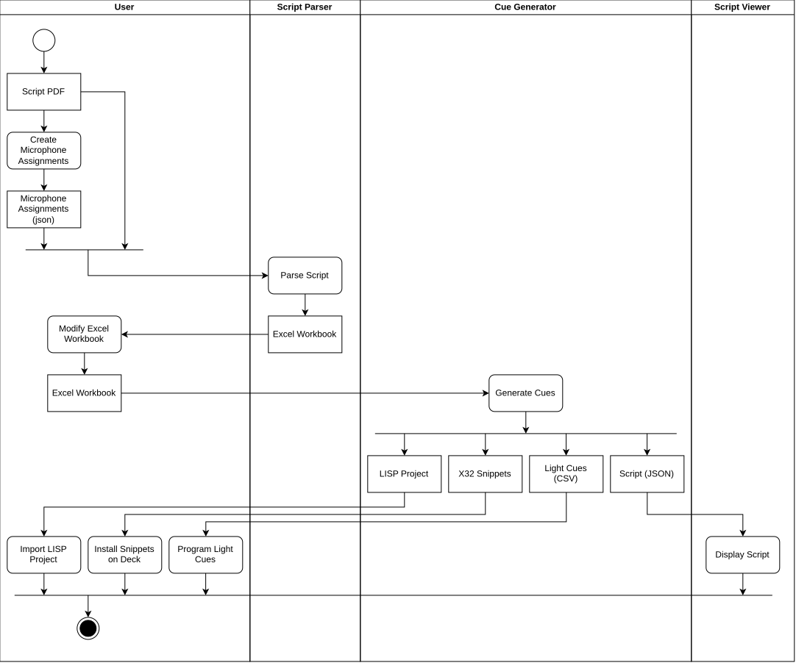

# Theater Utils
This repository features multiple utility programs for preparing and running theater shows.
The goal is to automate as much of the processes involved in preparing and running theater shows.

## Show Preparation
The following list of programs are used to prepare theater shows

1. Script Parser: Reads the theater script from PDF file, calculates microphone mutes with the help of a json file and
   parses the output into an excel workbook.
2. Cue generator: Reads the output of the previous application which has been slightly modified and generates all 
   necessary files for programming the decks and viewing the modified script.
3. Script Viewer: Displays the script (JSON) exported by the cue generator in a user interface together with mute
   annotations, audio and lighting commands. Next to every block, the generated LiSP cues, X32 snippets and light cues
   are shown. This application is intended to be used during the live theater show to read through the text in parallel.

The entire process for preparing a show can be observed in the following diagram:


## Running a show
TODO

- backup plans
- setup topology
- sequence diagrams
- OSC relay application

### OSC Relay
`src/osc_relay.py` receives the OSC messages of LiSP over UDP, removes the first address segment and forwards the
otherwise unchanged packet to the deck it names: `/x32/...` to `--x32 <host>:<port>` (the X32 listens on 10023),
`/mq/...` to `--magicq <host>:<port>` (the OSC receive port set on the MagicQ). It listens on `--listen-host`
(default 127.0.0.1) and `--listen-port` (default 9001, LiSP's default OSC destination).

## File formats

### The paradigm across all formats
The core philosophy of all formats handled by the applications builds on blocks.
Blocks are generated from the textbook PDF and represent everything that is happening during the show.
The blocks can later be converted into cues for some audio and light decks and displayed by the Script Viewer.

### Excel Workbook Format
The Excel workbook is produced by openpyxl and contains two Sheets:

- Characters
- Blocks

The Characters Sheet contains a table with the following columns:

| Column Name | Description |
| - | - |
| Mic | The assigned microphone channel on the audio deck |
| Actor | The real name of the actor |
| Character | The character played by the actor |
| Actions | The amount of actions of each actor according to the textbook |

If an actor plays multiple roles (characters) the table also contains multiple entries and one microphone channel is
reused.

The Blocks Sheet contains a table with the following columns:

| Column Name | Data Type                      | Description                |
| - |--------------------------------|----------------------------|
| ID | int | The unique ID of the block |
| Part | string | The part of the entire Show. Preplay or specific Act |
| Scene | int | Current scene |
| Page | int | The page number of the block in the original PDF file |
| Type | string | The type of the block. Can be one of `command`, `acting` or `dialogue` |
| Character | string | The name of the character speaking or acting |
| Direction | string | What happens on stage |
| Text | string | What the character currently says on the stage |
| Mute | string | Comma separated list of actor names that must be muted during this block |
| Unmute | string | Comma separated list of actor names that must be unmuted during this block |
| Audio Effect | string | The name of the audio effect to be played during this block |
| Light | string | The name of the light effect to be played during this block |

The table can contain additional columns which shall be ignored if the textbook is imported.

### Script (JSON) Format
The cue generator writes the script for the Script Viewer to the file given by `--script-output`. It contains the
blocks of the workbook together with every cue generated for the decks. Each cue refers back to the block(s)
triggering it by the block ID.

```json
{
    "version": 1,
    "blocks": [
        {"id": 7, "type": "dialogue", "part": "1. Akt", "scene": 1, "page": 2, "text": "...", "character": "Hugo",
         "direction": null, "mute": ["Ben"], "unmute": ["Anna"], "audio_effect": null, "light": "Spot Hugo"}
    ],
    "lisp_cues": [{"index": 4, "name": "1. Akt Scene 1 Block 7", "description": "Executes multiple actions at once", "block_id": 7}],
    "x32_snippets": [{"number": 2, "name": "A1S1 B7", "block_id": 7}],
    "light_cues": [{"cue": 2, "name": "Spot Hugo", "block_ids": [7, 19, 31]}]
}
```

| Key | Description |
| - | - |
| `version` | The version of the format, currently `1` |
| `blocks` | The blocks of the Blocks sheet with the same fields as its columns |
| `lisp_cues` | Every cue of the `.lsp` project: its `index` in the LiSP cue list, `name`, `description` and `block_id`. Empty if no `--lisp-output` is given |
| `x32_snippets` | Every generated snippet: its `number` on the X32 (= number of the `.snp` file), `name` and `block_id` |
| `light_cues` | Every light cue: its MagicQ `cue` number, the light effect `name` and the `block_ids` triggering it |

### Behringer X32 Scenes
Every time a block contains an actor to be muted / unmuted, another `.snp` file must be generated. The generated files
must be stored in a directory which is given by the cli argument `--snp-output-dir`. Every file must follow the pattern
`<theater-name>.<3-digit-number>.snp` which originally comes from the Behringer x32 edit application. The name of the
theater piece is given by the cli argument `--theater-name`. If the calculated number of scenes exceeds 100, a warning
message needs to be generated.
An example of a generated file can be found in `examples/Hugo.037.snp`.

### Lisp (Linux show player) project
The cue generator must also generate cues for the linux show player. The result is a complete `.lsp` project.
An example of such a json file is located at `examples/testcue 01.lsp`. Similar to the X32 scenes a new cue is
generated for every mute/unmute snippet, audio and light direction. The file names for the audio are the same as in
the workbook ending with `.wav`. For the light there are preprogrammed cues in the chamsys magicq deck which just need
to be triggered with an OSC cue. If one block contains multiple actions from mute/unmute, audio and light commands,
three cues must be generated that are triggered at the same time. There are three command line options which determine
what lands in the lisp project: `--lisp-mutes`, `--lisp-audio` and `--lisp-light`.
The project is written to the file given by `--lisp-output`.

Connection to the decks (LiSP 0.6.5 sends all OSC cues to one global host, the OSC relay, see below). The first
address segment of every OSC cue names the target deck (`/x32/...` or `/mq/...`):
- Mute/unmute cues are OSC cues that recall the X32 snippet generated as `.snp` file. 
  The files are numbered from 1, the console's internal snippet slot numbering starts from 00.
- Audio cues are media cues playing `<Audio Effect>.wav`, which is expected next to the `.lsp` file.
- Light cues are OSC cues `/mq/pb/<playback>/<cue>` (no arguments) that make the ChamSys MagicQ jump to the cue
  (see https://docs.chamsys.co.uk/magicq/1.9.9.x/manual/OSC.html). The playback is set by `--magicq-playback`
  (1-10, default 1, only the first 10 playbacks are controllable via OSC).
  Every light effect name gets one MagicQ cue number (numbered from 1 in order of first appearance, reused if the
  effect occurs again). The list of cues to program into the desk is written as CSV (`Cue`, `Effect`, `Blocks`) to
  the file given by `--light-output`.